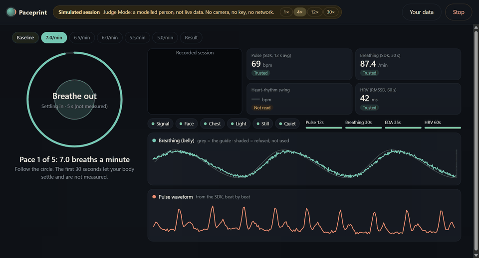
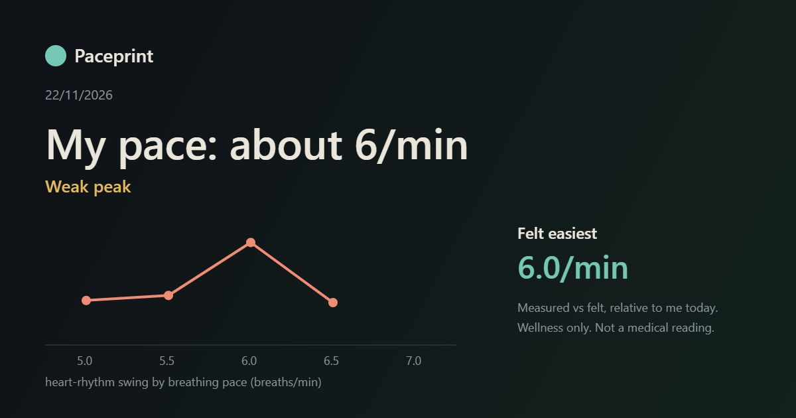

*This is a submission for the [Presage SmartSpectra SDK Challenge](https://dev.to/challenges/presage-2026-11-04)*

## What I Built
Most breathing apps assume six breaths a minute suits everyone. **Paceprint measures what suits you, from a webcam, and refuses to show numbers it can't trust.**

It's for someone like me: a final-year pharmacy student in exam week who has tried a breathing app and wondered whether the pace it prescribes is actually right for them.

You breathe along with a calm guide at five slow paces (7.0 to 5.0 breaths a minute). Paceprint reads your breathing and your pulse waveform through the SmartSpectra SDK, measures at which pace your heart rhythm and breathing move together most (a dose-response curve: pace is the dose, coupling the response), asks how easy each pace felt, and shows both: **measured vs felt**. Then it guides a five-minute session at your pace.

The rule that shaped everything: **never show a number the data can't support.** Move, step out of frame, sit under a flickering light, or lose the pulse waveform, and Paceprint pauses, tells you why, and throws that stretch away. Talking is the one thing it couldn't measure well enough to throw away: the SDK's talking flag fired during silence in our tests, and every fix we tried failed its test. So it warns you live, asks you up front to stay silent, and the result shows how much of each pace was flagged.

It's a wellness tool for self-awareness, not a medical device.

## Demo


*In the video, the setup check and the start of a baseline (labelled **LIVE** on screen) are recorded on my own webcam: the real SmartSpectra signal, including a real pause when my pulse signal weakened. The sweep, the "Moving" refusal, the rating, the guided session and the data drawer are Judge Mode playing the **simulated** session (the banner says so on screen). The result screens and the card are from my real live session.*



*Judge Mode, **simulated** session (a modelled person, labelled as such in the app). Not a live recording.*

Try it without a camera or key: Judge Mode replays a bundled **simulated** session through the real app and analysis code, labelled as simulated on screen. Needs Node 22.12+ and git; `npm install` downloads about 350 MB (mostly the SDK runtime):

```bash
git clone https://github.com/Bennytimz/paceprint.git
cd paceprint
npm install
npm run demo
```

## A Real Session
I ran one full live sweep on my laptop (Windows 11, built-in webcam). The SDK captured at 30 frames per second for the whole session, about 17 minutes, with no SDK errors. This is the share card the app made at the end:



| Pace | Heart-rhythm swing | Coupling (PLV) | Felt (1 hard – 5 easy) | Status |
|---|---|---|---|---|
| Baseline (normal breathing) | — | — | — | Not read: trustworthy data came only in short fragments |
| 7.0/min | — | — | 2 | Not read: trustworthy data came only in short fragments |
| 6.5/min | 3.5 bpm | 0.05 | 1 | Trusted |
| 6.0/min | 8.4 bpm | 0.07 | 3 | Trusted |
| 5.5/min | 4.1 bpm | 0.77 | 3 | Trusted |
| 5.0/min | 3.7 bpm | 0.61 | 3 | Trusted |

**The result: about 6 breaths a minute, weak peak.** The weak label is the app doing its job, because the two measures disagree. My heart rate swung most at 6.0/min (8.4 bpm, against 3.5 to 4.1 at the other paces), but at that pace the swing didn't keep steady timing with my breathing (coupling 0.07). At 5.5/min it did (0.77). A "clear" peak needs four things: it stands out from the paces either side, the three 30-second parts of the measurement agree, at least four paces were read, and coupling at the peak is at least 0.5. This session met the first three and failed the last, so Paceprint called it weak and said why. It still names 6.0/min because the ranking weights swing more than coupling.

One possible reason, which I haven't tested: heart rate also rises and falls on its own about six times a minute (a blood-pressure rhythm often called the Mayer wave), so a big swing at exactly 6/min need not come from breathing. This data can't tell the two apart.

Felt ease didn't separate the paces either: 6.0, 5.5 and 5.0 all felt "OK" (3 of 5). The card's "Felt easiest 6.0/min" is the first of that three-way tie. Seven breaths a minute and my baseline were not read: the trusted data came only in short fragments, so Paceprint left them out instead of guessing.

**What's real and what isn't.** The result screen and the card are from this live session. The session's raw signal stream wasn't saved ("Save session data" was off when I started), so it can't be replayed, and Judge Mode plays a simulated session instead. The app now says on the setup screen whether saving is on, and keeps the stream in memory until you leave the result so it can still be saved. The real-signal check anyone with a SmartSpectra key can run is `npm run verify-sdk` (output below).

## Code
https://github.com/Bennytimz/paceprint (MIT)

## How It Responds to Human Signals

| SDK signal | What Paceprint does with it |
|---|---|
| `cardio.arterialPressureTrace` (beat-level pulse waveform; relative, never blood pressure) | Detects each heartbeat, builds beat-to-beat heart rate, measures the heart-rate swing and phase locking at each pace. The core measurement. |
| `breathing.lowerTrace` / `upperTrace` (belly / chest) | Follow score (are you breathing with the guide?), time to lock, breathing phase for coupling, live trace on screen |
| `face.talking` | Shown live as a **Talking?** warning (never refuses data: in our tests it also fired during silence). Each pace's flagged share is an audit line on the result; paces at 40 % or more are marked caveated |
| `face.landmarks` | Face motion as a fraction of face width; refuses data while you move |
| `validationStatus` (all 16 codes) | Each mapped to a plain instruction ("Hold still", "Add more even light", "Sit back so your chest is in view") |
| Confidence / `stable` flags | Pulse 40, breathing 45, HRV 50 before a number is shown as Trusted; motion and flicker are checked independently |
| `cardio.pulseRate`, `breathing.rate`, `cardio.hrv` | Context only, with Trusted / Not read states and a warm-up strip; **not** used for coupling |
| `eda.trace` | Warm-up strip only; not interpreted |
| `processingStatus`, `error` | Friendly stop screens; automatic breathing-only fallback if the key isn't provisioned for cardio |

- **Beat by beat, not averaged.** The paces are 8.5 to 12 s per breath. The SDK pulse rate is a ~12 s average, which would erase the heart-rate swing. So Paceprint finds each beat on the pulse waveform itself, builds beat-to-beat heart rate, and measures the swing (a single-bin DFT at the pace) and phase locking (PLV) against the belly breathing trace. Everything about coupling is Paceprint's own calculation.
- **Validity layer.** Every moment is accepted or refused. Refused time is shaded on the traces, excluded from the analysis, and the measuring timer waits for good data (up to 45 s extra); a pace with too little clean data is shown as "not read", never guessed.
- **Honest output.** A certainty label (clear peak / weak peak / no clear peak today) that has to survive a second look: each pace's 90 s is split into three 30 s parts, and "clear" needs every part to agree and the peak to beat the paces either side by more than the part-to-part wobble. If phase locking is near 1.0 at every pace, it is dropped from the ranking and the result says so. Plus "not read" paces, a warm-up strip, and a breathing-only mode that says so.

Finding beats on the pulse waveform (`src/core/analysis.ts`):

```ts
export function detectBeats(pressure: Sample[], a: number, b: number): number[] {
  const fs = ANALYSIS.pressureFs;
  const raw = resample(pressure, a, b, fs);
  if (raw.length < fs * 5 || raw.some((v) => !Number.isFinite(v))) return [];
  const x = bandpass(raw, fs, 0.7, 3.2);
  const peaks = findPeaks(x, Math.round(ANALYSIS.ibiMin * fs * 0.9), 0.3 * std(x));
  // parabolic interpolation for sub-sample beat timing
  return peaks.map((i) => {
    const y0 = x[i - 1], y1 = x[i], y2 = x[i + 1];
    const den = y0 - 2 * y1 + y2;
    const off = den !== 0 ? (0.5 * (y0 - y2)) / den : 0;
    return a + (i + Math.max(-0.5, Math.min(0.5, off))) / fs;
  });
}
```

Refusing a moment (`src/core/validity.ts`, trimmed):

```ts
if (t - this.lastPacketT > VALIDITY.lostAfter) {
  add('lost', 'Signal lost', 'No reading from the camera right now. Visuals are frozen until it returns.');
} else {
  if (this.motion.some((m) => m.v > VALIDITY.motionMax)) add('motion', 'Moving', 'Hold still. Rest your arms and lean back.');
  if (this.flicker > VALIDITY.flickerMax) add('flicker', 'Flickering light', 'More even light: screens and some bulbs flicker.');
  // ...plus every non-OK SDK validation code and low pulse confidence
}
```

**Testing.** `npm test` runs 126 tests: a full simulated sweep that must find the right pace, refusal windows that must be excluded, a talking flag that fires on its own and must refuse nothing and change no ranking (only the audit line), a lens covered during settle that must never turn into a time to lock, a dead SDK session that must always end on an explained screen, a teardown that leaves the SDK able to start again in the same run, a live session where the window never opens the camera and preview frames are only drawn, nothing scored before the pulse waveform arrives (it took 36 s in the live check) and no gap in it ever filled in, the breathing-only fallback, a "no clear result" day, timestamp handling, the local store's delete-everything, and a replay of the bundled Judge Mode session. `npm run verify-sdk` checks every signal live on a real key:

```
=== Signals ===
PASS  face landmarks   packets=1552 samples=1653 stable=1653 first@5.1s last=undefined
PASS  talking flag     packets=1528 samples=1698 stable=1698 first@3.6s last=0.00
PASS  blinking         packets=1528 samples=1698 stable=1698 first@3.6s last=0.00
PASS  breathing rate   packets=21 samples=21 stable=12 first@16.4s last=13.98
PASS  chest trace      packets=1524 samples=1652 stable=688 first@5.2s last=0.05
PASS  abdomen trace    packets=1520 samples=1642 stable=685 first@5.2s last=-5.04
PASS  pulse rate       packets=38 samples=38 stable=38 first@36.0s last=88.34
PASS  pressure trace   packets=123 samples=1386 stable=1386 first@36.0s last=-0.08
PASS  HRV              packets=9 samples=9 stable=0 first@55.0s last=25.60
PASS  EDA trace        packets=123 samples=1446 stable=1446 first@36.0s last=0.04

10/10 signals received.
Validation states seen:
  0 Good: 1764
  1 No face: 1
  5 Too dark: 24
```

## Prize Categories
**Best Thoughtful Real-World Use.** A real question (is the "standard" pace right for me?), answered with the person's own data, with consent and honesty as design features: local only, no video stored, no AI services, telemetry off, measured network audit, one-click delete, and a visible refusal instead of a confident guess.

**Most Creative or Delightful Use.** A webcam becomes a breathing-pace finder: you breathe along with a calm pacer, and the app draws a curve of how your own heart rhythm answered each pace, puts how easy each pace felt beside it, and ends with a share card of your pace.

## Consent and Data Handling
This is the "In short" notice shown in the app before the camera turns on (the full notice is in [`docs/consent-and-data-handling.md`](https://github.com/Bennytimz/paceprint/blob/main/docs/consent-and-data-handling.md)):

- **What it does.** Paceprint uses your webcam to read your breathing and pulse signals while you breathe at a few slow paces, then shows which pace your heart rhythm and breathing moved together best.
- **Wellness only.** Paceprint is not a medical device. It does not diagnose, treat, or monitor any condition. Do not use it if you need medical monitoring. If you feel dizzy or unwell, stop and breathe normally.
- **Your video stays on this computer.** Paceprint never saves or sends video or camera frames.
- **What is saved.** Only session summaries (the paces, scores, your ease ratings, and times), in this computer's app data folder. If you switch on "Save session data" (off by default), also the signal numbers so you can replay a session, never video. Kept until you delete them. One click deletes everything.
- **No accounts, no cloud, no analytics, no AI services.**
- **The one network connection.** The camera analysis uses Presage's SmartSpectra SDK. It runs on this computer but connects to Presage (`cont-api.physiology.presagetech.com`) to check the API key, count usage, and download its models. Paceprint switches off the SDK's optional telemetry.
- **You are in control.** The camera starts only after you accept. A "Camera live" light shows whenever it is on. Stop turns it off at once.
- **18+ only.**

## Agent Session
Not included: the build sessions contain personal paths and details.

## Prior art
Resonance-frequency breathing is established in HRV-biofeedback research (Lehrer, Vaschillo & Vaschillo, 2000). Presage's own *Coherence by Presage Tech* app offers interactive breathwork with pulse and breathing tracking (we could not verify whether it runs a pace sweep), and phone apps such as Outliyr's Coherence, BreathTuner HRV and HRV4Biofeedback find a personal pace from a fingertip on the camera. Paceprint doesn't claim to be first. What it adds is the combination: webcam-only, validity-gated, honest about uncertainty, measured vs felt, consent-first, local, and no AI service.
